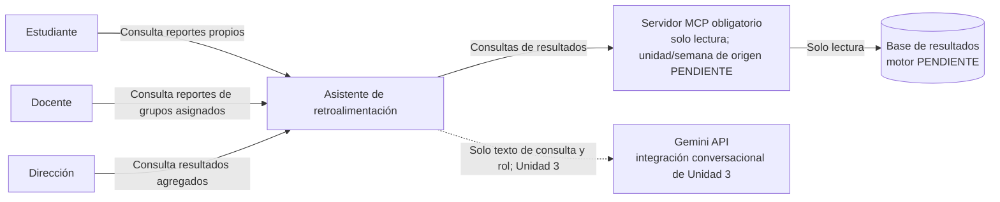
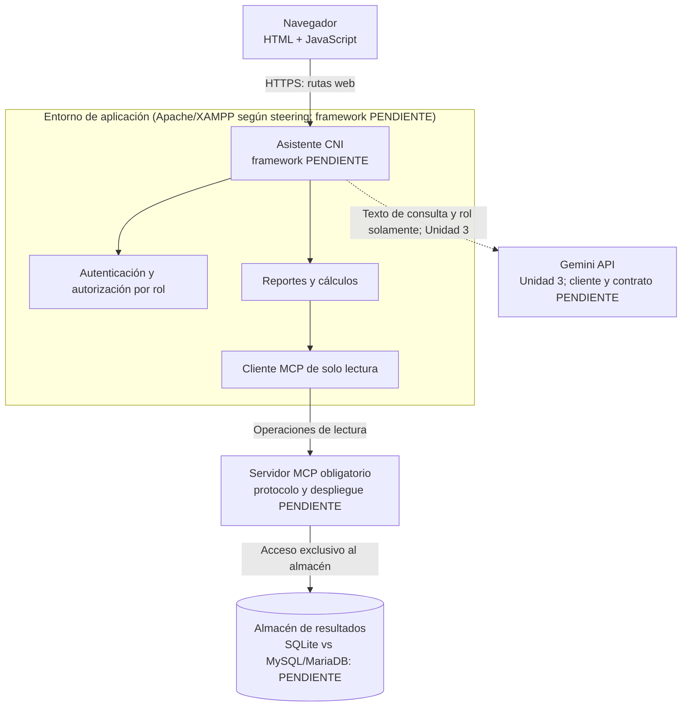
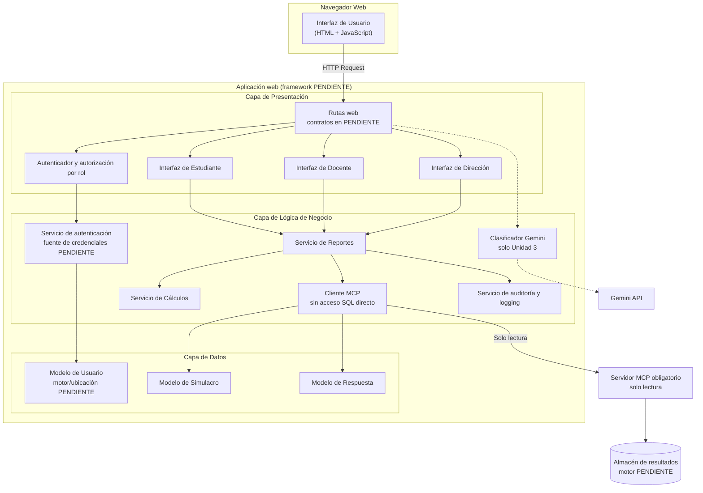
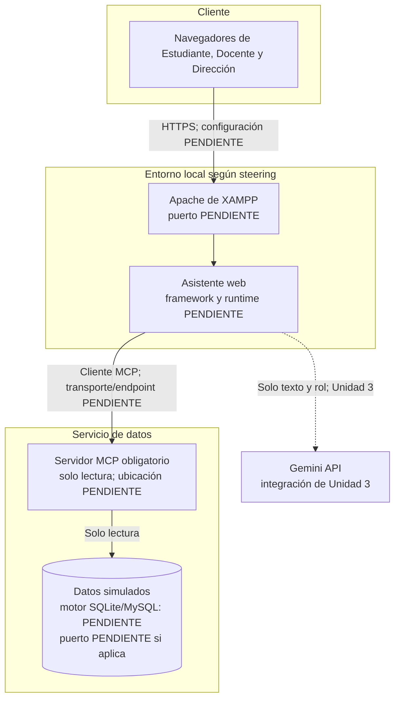
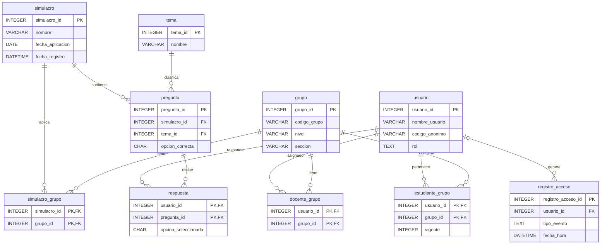

# Documento de Diseño Técnico
## Asistente de Retroalimentación para Simulacros de Admisión (CNI)

---

## Resumen

El **Asistente de Retroalimentación para Simulacros de Admisión del CNI** procesa resultados de simulacros para presentar retroalimentación a Estudiantes, Docentes y Dirección. La Dirección solo recibe información agregada; los datos de estudiantes usados en desarrollo son simulados.

**PENDIENTE:** La selección del framework aparece en conflicto: `tech.md` delega la decisión a ADR-001; existen dos documentos ADR-001 incompatibles; `tasks.md` especifica FastAPI/Python, mientras el diseño y uno de los ADR proponen PHP/CodeIgniter. El motor también está pendiente de armonización: MySQL/MariaDB en el steering y el modelo físico, SQLite en tareas y en `data/schema.sql`. El modelo lógico de esta página representa las fronteras funcionales, no resuelve esas decisiones.

---

## Arquitectura

## Diagrama C4 Nivel 1 (Contexto)



## Diagrama C4 Nivel 2 (Contenedores)



---

## Diagrama C4 Nivel 3 (Componentes)



---

## Diagrama de secuencia

### Caso de uso principal: "Estudiante consulta reporte individual"

```mermaid
sequenceDiagram
    actor Estudiante
    participant Browser as Navegador
    participant App as Asistente
    participant Auth as Autenticador
    participant Reportes as Servicio de Reportes
    participant MCPClient as Cliente MCP de solo lectura
    participant MCP as Servidor MCP obligatorio
    database Datos as Almacén (motor PENDIENTE)

    Estudiante->>Browser: Solicita reporte individual
    Browser->>App: GET /estudiante/reporte + token
    App->>Auth: Validar firma, expiración y rol
    Auth-->>App: Identidad validada; fuente de credenciales PENDIENTE
    App->>Reportes: Generar reporte del usuario autenticado
    Reportes->>MCPClient: Obtener simulacro y respuestas
    MCPClient->>MCP: Consulta de lectura
    MCP->>Datos: Lee registros autorizados
    Datos-->>MCP: Registros simulados
    MCP-->>MCPClient: Datos de solo lectura
    MCPClient-->>Reportes: Respuestas y preguntas
    Reportes->>Reportes: Calcular y ordenar resultados por tema
    Reportes-->>App: Reporte anonimizado
    App-->>Browser: Resultado del reporte
    Browser-->>Estudiante: Presenta retroalimentación
```

---

## Diagrama de despliegue



---

## Componentes e interfaces

| Componente | Responsabilidad | Carpeta | Historias que satisface |
|---|---|---|---|
| **Controlador de Autenticación** | Gestionar login, logout y validación de credenciales | `app/Controllers/Auth.php` | Req. 1 - Autenticación por rol |
| **Middleware de Autenticación** | Verificar sesión activa en cada request | `app/Filters/AuthFilter.php` | Req. 1 - Control de acceso |
| **Controlador Estudiante** | Manejar requests del rol estudiante | `app/Controllers/Estudiante.php` | Req. 4, 5, 6 - Reportes y comparaciones de estudiante |
| **Controlador Docente** | Manejar requests del rol docente | `app/Controllers/Docente.php` | Req. 7, 8 - Reportes grupales y detalle individual |
| **Controlador Dirección** | Manejar requests del rol dirección | `app/Controllers/Direccion.php` | Req. 9 - Resumen institucional agregado |
| **Servicio de Reportes** | Orquestar generación de todos los reportes | `app/Services/ReporteService.php` | Req. 4, 7, 9 - Lógica común de reportes |
| **Servicio de Cálculos** | Calcular métricas y porcentajes | `app/Services/CalculoService.php` | Req. 3, 5 - Procesamiento y clasificación |
| **Modelo Usuario** | Gestionar datos de usuarios y roles | `app/Models/UsuarioModel.php` | Req. 1 - Autenticación y roles |
| **Modelo Simulacro** | Gestionar datos de simulacros | `app/Models/SimulacroModel.php` | Req. 2, 4 - Procesamiento de simulacros |
| **Modelo Respuesta** | Gestionar respuestas de estudiantes | `app/Models/RespuestaModel.php` | Req. 2, 3 - Clasificación de errores |
| **Vistas HTML** | Presentar interfaces por rol | `app/Views/` | Todas - Interfaz de usuario |
| **JavaScript Frontend** | Interacciones dinámicas y AJAX | `public/assets/js/` | Todas - Experiencia de usuario |
| **Cliente MCP de solo lectura** | Único acceso a los resultados; sin conexión SQL directa desde el Asistente | `PENDIENTE` | Req. 2, 3–9, 11 |
| **Clasificador Gemini** | Clasificar intención; enviará solo consulta y rol, en la fase permitida | `PENDIENTE` | Req. 4–6, 10; activación en Unidad 3 `PENDIENTE` |
| **Auditoría y logging** | Registrar consultas, fallos y rechazos sin guardar el contenido de resultados | `PENDIENTE` | Req. 2.3, 2.5, 8.5, 11.3–11.4 |

> **PENDIENTE:** Las rutas `app/...` y `public/...` de la tabla son las propuestas por el diseño CodeIgniter preexistente, no una estructura aprobada. `tech.md` deja framework y raíz pública por resolver en ADR-001.

## Interfaces y contratos

Los nombres de rutas y métodos siguientes aparecen en `tasks.md` o en este diseño. Los campos, códigos de estado y esquemas no especificados en los requisitos se dejan como `PENDIENTE`, en vez de inventar un contrato.

| Interfaz | Entrada definida por las fuentes | Salida definida por las fuentes | Elementos `PENDIENTE` |
|---|---|---|---|
| `POST /auth/login` | Nombre de usuario y contraseña | Token y rol según la tarea 10.1 | Nombres definitivos de campos, esquema, códigos y contrato de error completo |
| `GET /estudiante/reporte` | Token del estudiante autenticado | Reporte del último simulacro | Esquema de respuesta, estados HTTP y fuente de credenciales |
| `GET /estudiante/comparacion` | Token del estudiante autenticado | Variación por tema de los dos simulacros aplicables | Parámetros/campos, estados HTTP y regla temporal común |
| `GET /estudiante/orientacion` | Token del estudiante autenticado | Temas priorizados, sin recomendaciones de material | Contrato exacto y datos que se muestran para historial insuficiente |
| `GET /docente/reporte-grupal` | Token docente y simulacro seleccionado | Errores agregados por tema del grupo | Nombre/tipo de parámetro, campos y estados HTTP |
| `GET /docente/estudiante/{id}` | Token docente e identificador anonimizado seleccionado | Detalle individual permitido para sus grupos | Tipo de identificador y esquema de respuesta |
| `GET /direccion/resumen` | Token de Dirección y simulacro seleccionado | Resultados agregados por tema/grupo | Parámetro, esquema y estados HTTP |
| `POST /chat` | Consulta textual; rol activo | Intención y respuesta de la funcionalidad correspondiente | Contrato JSON, errores y fecha de habilitación; Unidad 3 `PENDIENTE` |
| Operaciones MCP | Consultas de resultados nombradas en tarea 4.2 | Datos requeridos para reportes | Protocolo, transporte, endpoint, esquemas y contrato de error: `PENDIENTE` |

## Trazabilidad de criterios de aceptación

La asociación de componentes y tareas se agrupa por conjuntos cuando comparten responsabilidad; cada identificador de criterio dentro del conjunto queda incluido explícitamente.

| Criterios | Componente(s) del diseño | Tareas |
|---|---|---|
| R1.1–R1.7 | Autenticador, autorización por rol, middleware | 2.1, 2.3, 2.4, 10.1 |
| R2.1–R2.5 | Cliente MCP, validación de datos, logging | 4.2, 4.3, 9.1 |
| R3.1–R3.5 | Servicio de Cálculos, datos de preguntas/respuestas | 5.1, 5.2 |
| R4.1–R4.6 | Servicio de Reportes, clasificador de intención, autorización | 2.3, 2.4, 5.3, 6.1, 8.2, 10.2 |
| R5.1–R5.7 | Servicio de Cálculos, clasificador de intención, reporte del estudiante | 5.1, 5.2, 6.1, 8.2, 10.2 |
| R6.1–R6.5 | Orientación de refuerzo, ordenamiento, clasificador de intención | 5.3, 5.5, 8.2, 10.2, 12.3 |
| R7.1–R7.5 | Reporte grupal, cliente MCP, selección de simulacro | 4.2, 6.3, 10.3, 12.4 |
| R8.1–R8.6 | Reporte individual docente, autorización por grupo, cliente MCP | 2.3, 2.4, 4.2, 6.3, 10.3, 12.4 |
| R9.1–R9.7 | Resumen agregado, cliente MCP, selección de simulacro | 4.2, 6.5, 10.4, 12.5 |
| R10.1–R10.6 | Cliente y clasificador Gemini; router de chat | 8.1, 8.2, 8.3, 10.5 |
| R11.1–R11.5 | Protección de datos, MCP de solo lectura, auditoría | 1, 4.2, 6.6, 9.1, 9.2, 13.2, 15.2 |

---

## Modelo de datos

El modelo relacional de abajo resume las entidades ya descritas en `data-model.md`. El motor físico permanece **PENDIENTE**: el steering indica MySQL/MariaDB y requirements/tasks nombran SQLite. La aplicación no conecta directamente a este almacén; el acceso a resultados pasa por el MCP obligatorio.



---

## Punto de extensión para la Unidad 3

En la **Unidad 3**, se integrará un **módulo de conversación** que permitirá a los usuarios formular consultas en lenguaje natural español. Este módulo se conectará como un **controlador adicional** (`app/Controllers/Chat.php`) dentro de la arquitectura existente sin afectar la funcionalidad core.

**Punto de integración previsto:**
- **Ruta**: `/chat` - Endpoint POST indicado por el diseño y las tareas; el contrato de entrada/salida queda `PENDIENTE`.
- **Flujo**: Gemini clasifica la intención antes de consultar resultados mediante el MCP. La aplicación envía a Gemini solo texto de consulta y etiqueta de rol.
- **Datos**: Reutiliza los servicios de reportes; ningún resultado ni identificador de estudiante se envía a Gemini.
- **Interfaz**: Se prevé un widget de chat en las vistas existentes.
- **Calendario**: la integración conversacional se ubica en Unidad 3 según el diseño; conciliar su habilitación con las tareas y requisitos queda `PENDIENTE`.

Este diseño permite una integración no invasiva del módulo conversacional, manteniendo la separación de responsabilidades y reutilizando toda la lógica de negocio ya desarrollada.

---

## Decisiones no tomadas

Las siguientes decisiones quedan pendientes para el diseño detallado e implementación:

1. **Esquema detallado de base de datos**: Definición exacta de índices, claves foráneas y constraints específicos de MySQL
2. **Estrategia de sesiones**: Implementación específica de manejo de sesiones (archivos, base de datos, o memoria)  
3. **Validaciones de formularios**: Reglas de validación detalladas para cada campo de entrada de datos
4. **Manejo de archivos temporales**: Estrategia para caches de reportes y archivos de trabajo temporal
5. **Logging y auditoría**: Implementación específica del sistema de trazabilidad de accesos requerido por Ley 29733
6. **Configuración de entorno**: Variables de configuración específicas para desarrollo, pruebas y producción
7. **Estrategia de backup**: Procedimientos de respaldo de la base de datos simulada
8. **Optimizaciones de rendimiento**: Índices de base de datos y estrategias de caché para consultas frecuentes
9. **Diseño visual detallado**: Especificaciones de CSS, paleta de colores y elementos de interfaz específicos
10. **Pruebas automatizadas**: Framework y estrategia de testing para validación de funcionalidades

## Historial de cambios

| Fecha | Hallazgo | Cambio |
|---|---|---|
| 2026-10-09 | Faltaban C4 nivel 1, modelo ER en este documento e interfaces contractuales; C4/flujo/despliegue permitían acceso SQL directo y omitían MCP; stack y capacidades no estaban trazados por criterio. | Añadí contexto C4, fronteras MCP, secuencia y despliegue sin conexión directa, ER, contratos con datos desconocidos `PENDIENTE`, componentes faltantes y matriz de trazabilidad. Dejé sin decidir framework, motor, endpoint MCP y calendario en conflicto. |